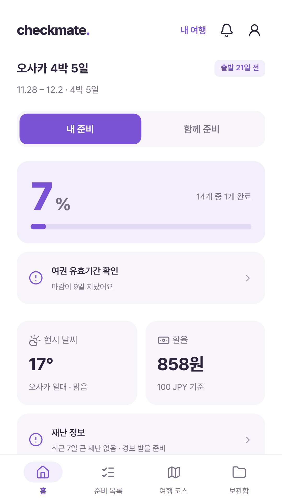
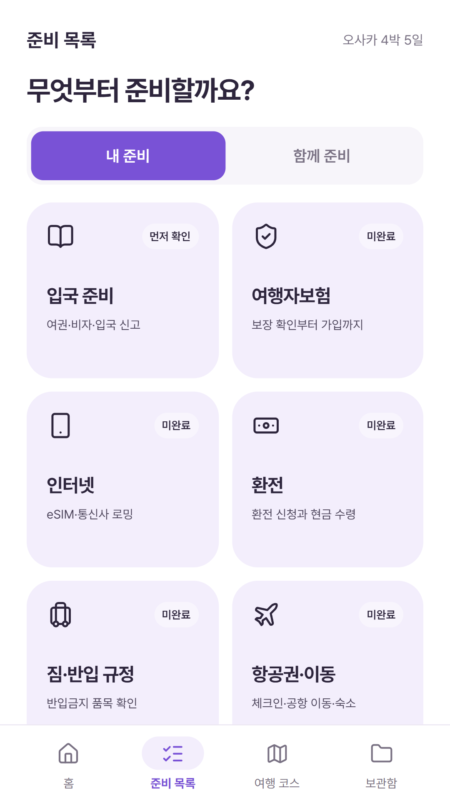
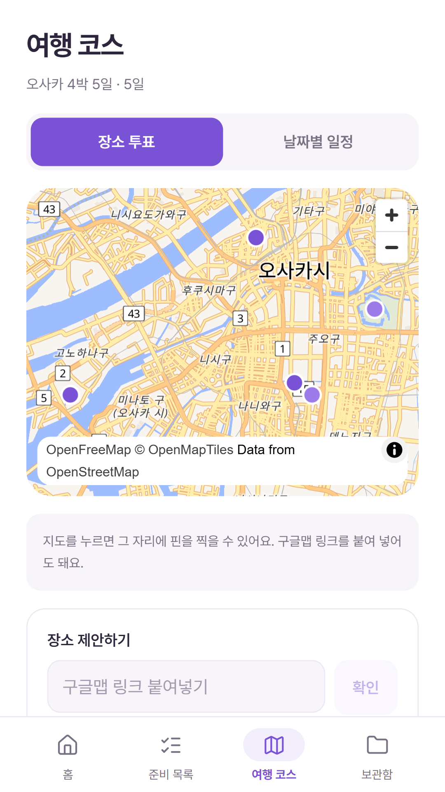
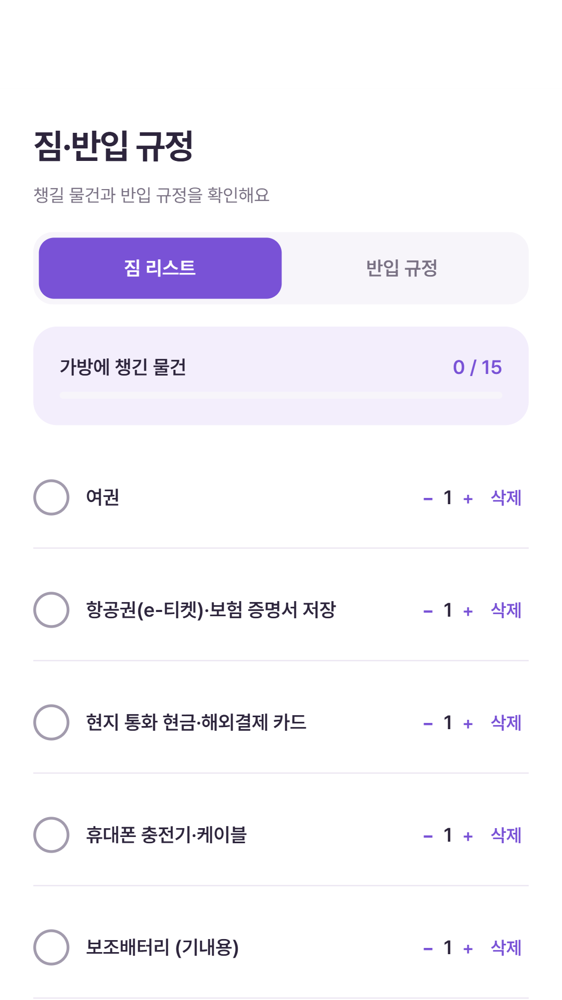
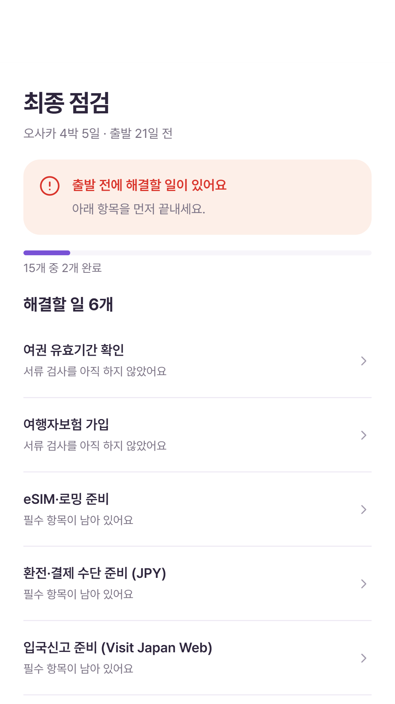
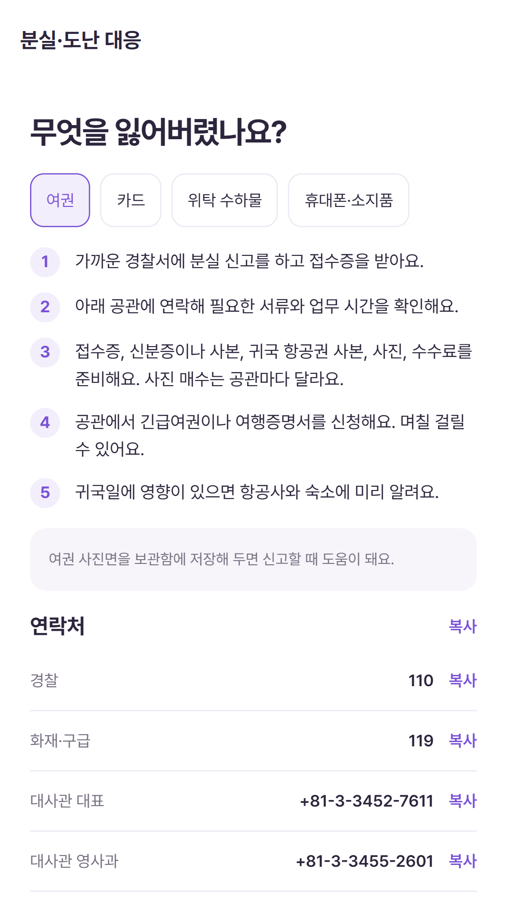

# Checkmate

해외여행 준비를 출발일 기준 할 일 목록으로 정리하고, 일행과 함께 챙기는 Android 앱입니다.
여행지와 날짜를 넣으면 시기별 체크리스트가 만들어지고, 일행은 6자리 방 코드로 들어와 같은 여행을 준비합니다. 회원가입은 없습니다.

- 웹 데모: https://readygo.expo.app (지도, 문자 인식, 알림은 앱에서만 동작)
- Android: Google Play 비공개 테스트 중
- SVC Seoul AI 해커톤 본선 과제 "출발 전, D-day 점검 에이전트" · 팀 여행의 숲


| 홈 | 준비 목록 | 여행 코스 | 짐 |
|---|---|---|---|
|  |  |  |  |

| 출발 전 점검 | 동행 | 분실 대처 |
|---|---|---|
|  |  |  |

## 풀려는 문제

해외여행 준비는 여권 유효기간, 비자, 입국 서류, 보험, eSIM, 기내 반입 규정처럼 챙길 것이 많고 시기도 제각각입니다. 일행이 있으면 누가 무엇을 했는지도 따로 확인해야 합니다.
Checkmate는 이걸 "출발까지 며칠 남았고, 오늘 무엇을 하면 되는지"로 바꿔 보여 주는 데 집중했습니다.

## 주요 기능

- **출발일 기준 체크리스트**: 여행지(일본·베트남·태국·대만·미국), 일정, 인원으로 D-30부터 출발 당일까지 할 일을 만듭니다. 놓친 일은 위로 올라옵니다.
- **서류 확인**: 여권 아랫부분(MRZ)과 보험 증서를 찍으면 기기 안에서 글자를 읽어 만료일과 보장 기간을 여행 일정과 비교합니다. 기간이 모자라면 해결할 때까지 그 항목을 완료할 수 없습니다.
- **함께 준비**: 방 코드로 참여(익명 로그인), 개인/공용 체크리스트, 담당자 지정, 실시간 반영. 일행에게는 진행률만 보이고 개인 항목과 서류 내용은 보이지 않습니다.
- **여행 코스**: 구글 지도 링크를 붙여넣거나 지도에 핀을 꽂아 장소를 제안하고 투표합니다. 고른 장소로 날짜별 일정 초안을 만듭니다.
- **짐과 반입 규정**: 기간과 여행지에 맞춘 짐 목록, 보조배터리 Wh 계산과 액체류 같은 기내 반입 판정.
- **AI 준비 도우미**: 오늘 먼저 할 일 정리, 앱 안의 정보만 근거로 한 질문 답변, 일정 초안 다듬기.
- **여행 중**: 현지 날씨, 환율, 비상 연락처, 최근 재난 정보, 분실 시 대처 안내, 항공권·보험 파일 보관함. 인터넷이 끊겨도 저장된 여행 정보는 볼 수 있습니다.

## 설계에서 신경 쓴 점

**AI는 필요한 곳에만**
체크리스트 생성, 반입 판정, 서류 대조, 장소 묶기는 모두 규칙 코드로 처리하고, AI는 문장으로 정리해야 하는 세 곳(오늘 할 일, 질문 답변, 일정 다듬기)에만 씁니다. 홈 브리핑은 규칙으로 상황 변화(놓친 일, D-day 단계, 비 예보, 일행 진행 정체)를 먼저 감지하고, 상황이 바뀌었을 때만 AI를 부릅니다. AI가 실패하거나 한도를 넘으면 규칙 기반 결과로 대체합니다.

**비용 상한을 코드와 인프라 양쪽에**
- AI 호출은 Supabase Edge Function을 거치고, 키는 서버에만 있습니다. 여행당·앱 전체 하루 한도와 같은 날 결과 캐시를 둡니다.
- 지도는 무료로 쓸 수 있는 SDK 지도만 쓰고 장소 검색·지오코딩·길찾기 유료 API는 쓰지 않습니다. 장소 위치는 지도 링크 해석과 OpenStreetMap으로 찾습니다.
- 구글 클라우드에 비용이 1원이라도 잡히면 결제를 자동으로 끊는 함수를 붙였습니다([infra/billing-killswitch](infra/billing-killswitch)).

**개인정보를 기기 밖으로 보내지 않기**
여권과 보험 글자 인식은 기기 안(Android ML Kit, 웹은 Tesseract.js)에서 합니다. 여권번호는 파서 결과에서 빼고 저장하지 않으며, 서류 사진과 결과는 기기에만 둡니다. AI에는 체크리스트 제목과 진행률 같은 요약만 보냅니다. 처리 방침: [docs/privacy-policy.md](docs/privacy-policy.md)

**실기기에서 만난 문제**
- 릴리스 빌드에서 앱이 바로 꺼짐: R8 축소가 알림(WorkManager)이 쓰는 클래스를 지워서, keep 규칙을 추가했습니다.
- 한국 여권 MRZ 인식 실패: 2번째 줄만으로 만료일을 읽고, 체크 디지트 검증과 0/O 오인식 보정을 넣었습니다.
- Play 설치본에서 지도가 빈 화면: Play 앱 서명 인증서의 SHA-1을 지도 키 제한에 추가했습니다.
- Android에서 장소 찾기 실패: OpenStreetMap이 기본 HTTP 클라이언트 요청을 거절해서, 앱을 밝히는 User-Agent를 붙였습니다.
- 재난 정보가 "불러오지 못함"으로 표시: 재난이 없을 때 오는 빈 응답(204)을 오류로 처리하던 것을 고쳤습니다.

## 기술 스택

| 영역 | 사용 |
|---|---|
| 앱 | Expo SDK 58, React Native, TypeScript, expo-router, Zustand |
| 서버 | Supabase (Postgres, RLS, 익명 로그인, Realtime, Edge Functions) |
| AI | Claude API (Haiku), Edge Function 경유 |
| 지도·위치 | react-native-maps (Google Maps SDK), OpenStreetMap Nominatim |
| 문자 인식 | Google ML Kit (Android), Tesseract.js (웹) |
| 외부 데이터 | Open-Meteo(날씨), USGS·P2P지진정보·GDACS(재난), 환율 API |
| 빌드·배포 | EAS Build (APK/AAB), EAS Hosting (웹) |

```
앱 (Expo) ──── Supabase: DB · 익명 로그인 · 실시간 반영
   │                 └─ Edge Functions ── Claude API
   ├─ 기기 안: 체크리스트 규칙, 반입 판정, 서류 글자 인식, 보관함
   └─ 무료 공개 API: 날씨, 재난, 환율, OpenStreetMap
```

## 실행

```bash
npm install
```

```bash
npm run web
```

- 웹에서는 지도, 문자 인식, 알림, 공유받기가 동작하지 않습니다. 전체 기능은 개발 빌드(`npx eas-cli build -p android --profile preview`)로 확인합니다.
- Supabase 값이 없으면 로컬 모드(이 기기에만 저장)로 동작합니다. 첫 화면의 **샘플 여행으로 둘러보기**로 샘플 여행을 열 수 있습니다.

### 검사

```bash
npm run typecheck
```

```bash
npm test
```

MRZ·보험 글자 해석, 반입 판정, D-day 분류, 지도 링크 해석, 서류 완료 조건, 출발 전 점검 등 78개 테스트가 있습니다.

### 환경변수

`.env.example`를 `.env`로 복사해 채웁니다. 앱에는 공개용 값만 들어갑니다.

| 변수 | 설명 |
|---|---|
| `EXPO_PUBLIC_SUPABASE_URL` | Supabase 프로젝트 URL |
| `EXPO_PUBLIC_SUPABASE_ANON_KEY` | Supabase 공개(anon) 키 |
| `GOOGLE_MAPS_ANDROID_API_KEY` | Android 지도 키 (패키지·서명 제한, Maps SDK 전용) |

Claude API 키(`ANTHROPIC_API_KEY`)는 Supabase Secrets에만 둡니다. 모델은 `AI_MODEL`로 바꿀 수 있습니다.

### 서버 설정

1. `supabase/schema.sql`, `supabase/migrations/` 순서대로 실행
2. Authentication에서 Anonymous sign-ins 켜기
3. Edge Functions 배포: `ai-briefing`, `ai-itinerary`, `ai-ask`, `maps-resolve`

## 구조

```
src/
  app/          화면 (expo-router). trip/[id]/ 아래가 여행 방 탭: 홈 · 준비 목록 · 여행 코스 · 보관함
  components/   UI·기능 컴포넌트
  lib/          순수 로직과 테스트: checklist, agentSignals, mrz, ocrText, baggage, itinerary, mapsLink …
  services/     저장소(로컬/Supabase), 문자 인식, 알림, 위치 찾기, 재난·날씨
  store/        Zustand 상태 (서류·보관함은 기기에만)
  data/         나라별 규칙 데이터
supabase/       스키마, 마이그레이션, Edge Functions
infra/          구글 클라우드 결제 차단 함수
docs/           개인정보 처리방침, 스크린샷, 개발 기록(dev-notes)
design_ref/     팀 디자이너의 화면 시안
```

## 한계

- 나라별 입국 요건과 반입 규정 데이터는 공식 출처 확인 전 초안입니다([DATA_TODO.md](DATA_TODO.md)). 앱 안에서도 참고용이라고 안내합니다.
- 지원 여행지는 5개 나라입니다.
- 날씨 API(Open-Meteo) 무료판은 비상업용이라, 유료화하면 교체가 필요합니다.

## 만든 사람

- 팀 **여행의 숲** (SVC Seoul AI 해커톤 본선)
- 화면 디자인: 팀 디자이너 시안([design_ref](design_ref))
- 개발·배포: [uzo5525](https://github.com/uzo5525)
- 개발 과정에서 Claude(Claude Code)를 함께 사용했고, 앱의 AI 기능은 Claude API를 씁니다. 초기 요구사항과 진행 기록은 [docs/dev-notes](docs/dev-notes)에 있습니다.
